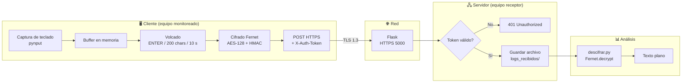
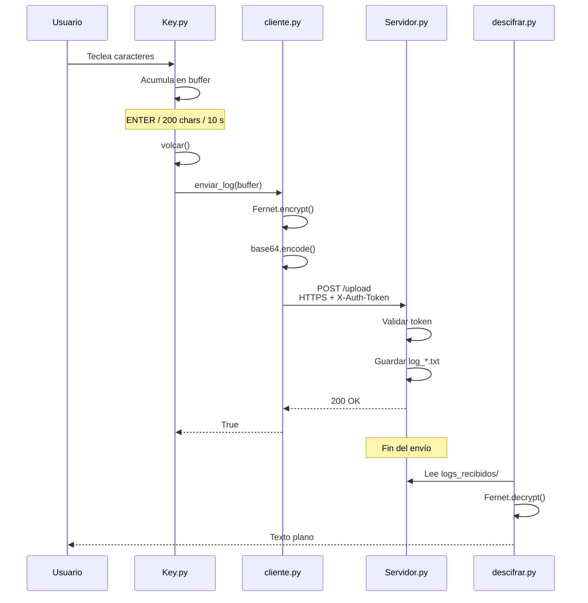

# Keylogger## Contexto académico

- **Proyecto:** Desarrollo de un keylogger en entorno controlado para el análisis de amenazas en sistemas Windows, Linux y macOS
- **Autora:** Estefania Becerra Quintero
- **Institución:** CIAF Educación Superior
- **Año:** 2026

Este repositorio contiene el código, la documentación y los artefactos
técnicos desarrollados como parte del proyecto de grado. Todas las
pruebas se realizan en **entornos controlados y sobre equipos propios**
o con consentimiento explícito.

> ⚠️ **Aviso legal:** Este software solo debe ejecutarse en equipos propios o en equipos de terceros con **consentimiento explícito y por escrito**. Su uso no autorizado constituye un delito en la mayoría de jurisdicciones.

---

## Tabla de contenido

- [Descripción](#descripción)
- [Arquitectura](#arquitectura)
- [Flujo de un log](#flujo-de-un-log)
- [Componentes](#componentes)
- [Requisitos](#requisitos)
- [Instalación](#instalación)
- [Configuración](#configuración)
- [Uso](#uso)
- [Decisiones de diseño](#decisiones-de-diseño)
- [Pruebas](#pruebas)
- [Limitaciones](#limitaciones)
- [Mejoras futuras](#mejoras-futuras)
- [Estructura del proyecto](#estructura-del-proyecto)

---

## Descripción

El sistema captura eventos de teclado, los agrupa en un *buffer* con límite configurable, y los envía cifrados a un servidor remoto por HTTPS. El servidor almacena los logs cifrados; un script auxiliar los descifra para su análisis.

**Objetivos del proyecto:**

1. Demostrar la captura de eventos de teclado a bajo nivel con `pynput`.
2. Aplicar cifrado simétrico **Fernet** (AES-128-CBC + HMAC-SHA256) al contenido de los logs.
3. Establecer un canal **HTTPS** con certificado autofirmado para proteger también la capa de transporte.
4. Documentar el diseño, las decisiones y las limitaciones del sistema.

---

## Arquitectura

El sistema sigue un modelo **cliente–servidor con cifrado en dos capas** (*defensa en profundidad*).



### Capas de seguridad

| Capa | Mecanismo | Protege |
|---|---|---|
| Aplicación | Fernet (AES-128-CBC + HMAC-SHA256) | El contenido del log, incluso si TLS se rompe |
| Transporte | TLS 1.3 (certificado autofirmado) | Todo el canal: cabeceras, token, y payload cifrado |
| Autenticación | Header `X-Auth-Token` sobre TLS | Solo clientes con token pueden enviar |

**¿Por qué doble cifrado?** TLS protege el canal, pero si un atacante logra un MITM con un certificado válido (por ejemplo, instalando su propia CA en el cliente), TLS cae. Fernet garantiza que **aun en ese escenario**, el contenido sigue siendo ilegible sin la clave.

---

## Flujo de un log



---

## Componentes

| Archivo | Rol |
|---|---|
| `Key.py` | Captura eventos de teclado con `pynput`, gestiona modificadores (Shift, Caps Lock, AltGr) y teclas muertas (tildes, ñ). Vuelca el buffer por ENTER, por límite de 200 caracteres, o cada 10 s. |
| `cliente.py` | Módulo de envío. Cifra con Fernet, codifica en base64, hace POST HTTPS con token de autenticación. |
| `Servidor.py` | Servidor Flask con HTTPS. Valida token, guarda el cuerpo cifrado en `logs_recibidos/`. |
| `descifrar.py` | Script auxiliar. Lee los archivos cifrados y los descifra con la misma clave Fernet. |
| `generar_cert.py` | Genera `cert.pem` y `key.pem` (certificado autofirmado RSA 2048, válido para la IP local). |
| `cert.pem` / `key.pem` | Certificado y clave privada del servidor. **No se versionan** (están en `.gitignore`). |

---

## Requisitos

- Python **3.10+**
- Sistema operativo: **Windows 10/11** (probado), Linux con X11 (compatible, con limitaciones)
- Dependencias Python:

```
cryptography
requests
flask
pynput
```

---

## Instalación

```bash
# 1. Clonar el repositorio
git clone <url-del-repo>
cd Keylogger

# 2. Crear y activar entorno virtual
python -m venv venv
# Windows
.\venv\Scripts\Activate.ps1
# Linux/Mac
source venv/bin/activate

# 3. Instalar dependencias
pip install cryptography requests flask pynput

# 4. Generar el certificado autofirmado (solo la primera vez)
python generar_cert.py
```

---

## Configuración

Antes de ejecutar, edita estos valores:

### `cliente.py`
```python
CLAVE = b"<tu-clave-Fernet>"                       # Genera con Fernet.generate_key()
URL_SERVIDOR = "https://<IP-del-servidor>:5000/upload"
TOKEN_SECRETO = "<token-compartido>"
```

### `Servidor.py`
```python
TOKEN_SECRETO = "<mismo-token-que-el-cliente>"
```

### `descifrar.py`
```python
CLAVE = b"<misma-clave-que-el-cliente>"
```

> **Recomendado:** pasar `CLAVE` y `TOKEN_SECRETO` por variables de entorno en lugar de hardcodearlas.

---

## Uso

### Terminal 1 — Servidor
```bash
python Servidor.py
```
Salida esperada:
```
[+] Servidor HTTPS iniciado en https://0.0.0.0:5000
[+] Certificado: cert.pem | Clave: key.pem
 * Running on https://192.168.x.x:5000
```

### Terminal 2 — Cliente (keylogger)
```bash
python Key.py
```
Salida esperada:
```
[INFO] Escuchando teclado... (ESC para salir)
[INFO] Envío al servidor: ACTIVADO
```

Cada vez que se presione ENTER o pasen 10 segundos, el buffer se volcará y se enviará al servidor. Presiona **ESC** para salir limpiamente.

### Verificación
```bash
python descifrar.py
```
Imprime el contenido descifrado de todos los logs recibidos.

---

## Decisiones de diseño

| Decisión | Alternativa | Justificación |
|---|---|---|
| **Fernet** para el contenido | AES puro, RSA | Fernet ya incluye autenticación (HMAC) y evita errores comunes de implementación. Es el estándar recomendado por la librería `cryptography`. |
| **HTTPS con certificado autofirmado** | HTTP plano, Let's Encrypt | Let's Encrypt requiere dominio público, imposible en LAN. El certificado autofirmado protege el canal sin depender de una CA. |
| **Flask** para el servidor | FastAPI, Django, socket puro | Minimalista, ideal para un servidor de un solo endpoint. FastAPI sería mejor si hubiera múltiples endpoints y necesidad de validación. |
| **`pynput`** para la captura | `keyboard`, hooks de Windows API | Multiplataforma, API simple. `keyboard` es más potente en Windows pero menos portable. |
| **Envío en hilo aparte** | Envío síncrono | Evita bloquear el listener del teclado si el servidor tarda o no responde. |
| **Buffer con volcado periódico** | Envío por cada tecla | Reduce el tráfico de red y agrupa contexto en bloques legibles. |
| **Token en header** | Basic Auth, JWT | Simple y suficiente para el alcance del proyecto. JWT sería mejor si hubiera múltiples usuarios. |

---

## Pruebas

### Verificación funcional

1. **Cifrado / descifrado round-trip:**
   ```bash
   python -c "from cliente import fernet; c=fernet.encrypt(b'hola'); print(fernet.decrypt(c))"
   ```
   Esperado: `b'hola'`

2. **Servidor rechaza sin token:**
   ```bash
   curl -k -X POST https://192.168.40.14:5000/upload -H "Content-Type: application/json" -d '{"contenido":"x"}'
   ```
   Esperado: `{"error":"No autorizado"}, 401`

3. **Cliente envía correctamente:**
   ```bash
   python -c "from cliente import enviar_log; print(enviar_log('prueba'))"
   ```
   Esperado: `True`

### Verificación de seguridad

4. **Wireshark** capturando en la interfaz de red (o loopback) con filtro `tcp.port == 5000`:
   - Se observan paquetes `TLSv1.3 Client Hello`, `Server Hello`, `Certificate`, `Application Data`.
   - El contenido de `Application Data` es ilegible (`17 03 03 ...`).

5. **Búsqueda en la captura** por el string `X-Auth-Token` o el texto enviado: **0 coincidencias**.

---

## Limitaciones

1. **Certificado autofirmado**: requiere distribuir `cert.pem` a cada cliente. No escala.
2. **Clave Fernet en el cliente**: si un atacante accede al cliente, obtiene la clave y puede descifrar. Solución real: **criptografía asimétrica** (solo clave pública en el cliente).
3. **Sin persistencia offline**: si el servidor está caído, los logs se pierden. Ver *Mejoras futuras*.
4. **Layouts de teclado**: solo se mapean correctamente QWERTY español/latino e inglés. Otros layouts (AZERTY, Dvorak) no están cubiertos.
5. **Sin captura de portapapeles**: un usuario que pega una contraseña no la escribe. No se registra.
6. **Sin registro de ventana activa**: no se sabe en qué aplicación se escribió.
7. **Dependencia de `pynput` en Windows**: Caps Lock y algunas teclas especiales se comportan distinto según la versión.
8. **Flask en modo desarrollo**: se advierte `WARNING: This is a development server`. Para producción, usar Gunicorn + Nginx.

---

## Mejoras futuras

- [ ] **Cola persistente de reintento** (patrón *store-and-forward*).
- [ ] **Cifrado asimétrico (RSA)**: solo clave pública en el cliente.
- [ ] **Captura de portapapeles** (`Ctrl+V`).
- [ ] **Registro de ventana activa** (`pygetwindow` / `win32gui`).
- [ ] **Panel web** de administración con logs descifrados en el navegador.
- [ ] **Tests automatizados** con `pytest`.
- [ ] **Empaquetado** con `PyInstaller` (`Key.exe`).
- [ ] **Rotación de logs** por día en el servidor.

---

## Estructura del proyecto

```
Keylogger/
├── .gitignore
├── README.md
├── generar_cert.py        # Genera cert.pem y key.pem
├── cert.pem               # Certificado del servidor (NO versionar)
├── key.pem                # Clave privada del servidor (NO versionar)
├── Key.py                 # Captura y volcado de teclas
├── cliente.py             # Cifrado y envío HTTPS
├── Servidor.py            # Flask HTTPS que recibe logs
├── descifrar.py           # Descifra logs recibidos
├── logs_recibidos/        # Logs cifrados (NO versionar)
│   └── log_YYYYMMDD_HHMMSS_xxxxxx.txt
├── keylog.txt             # Log local en texto plano (NO versionar)
└── venv/                  # Entorno virtual (NO versionar)
```

---

## Autor

**Estefania Becerra Quintero**
Proyecto de grado — Desarrollo de un keylogger en entorno controlado para el análisis de amenazas en sistemas Windows, Linux y macOS
CIAF Educación Superior — 2026

## Licencia

Este proyecto está bajo la **Academic Use License (AUL) v1.0**.
Consulta el archivo [LICENSE](LICENSE) para los términos completos.

Resumen: uso exclusivamente académico y de investigación. Prohibido
el uso comercial y la instalación en equipos de terceros sin
consentimiento explícito y por escrito.

Copyright (c) 2026 Estefania Becerra Quintero.